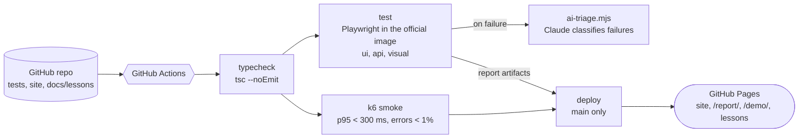
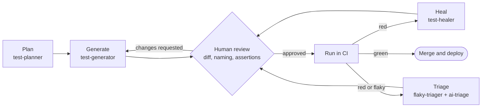

# QA Agent Portfolio

**AI agents are part of the testing workflow.** A Playwright + TypeScript framework (POM, API, visual) that Claude Code
plans, generates, reviews and heals, with a human approving every step, built, tested and deployed entirely from GitHub.

[](https://github.com/nguyenvanlinh14/qa-agent-portfolio/actions/workflows/ci.yml)
[](https://nguyenvanlinh14.github.io/qa-agent-portfolio/)


## Live links

| What | Link |
|---|---|
| Portfolio site | https://nguyenvanlinh14.github.io/qa-agent-portfolio/ |
| Latest Playwright report (from CI, every push to `main`) | https://nguyenvanlinh14.github.io/qa-agent-portfolio/report/ |
| TaskFlow demo app (the app under test) | https://nguyenvanlinh14.github.io/qa-agent-portfolio/demo/ |
| Lessons (Vietnamese) | https://nguyenvanlinh14.github.io/qa-agent-portfolio/#lessons |
| Open-source playbook | https://nguyenvanlinh14.github.io/qa-agent-portfolio/lessons/open-source-playbook.html |

## Architecture



The agent loop that produces and maintains the tests:



No agent merges anything by itself: planning, generated code, healed selectors and triage conclusions all pass a human gate.

## Tech stack

- **Test framework:** Playwright Test 1.64, TypeScript, Page Object Model, custom fixtures, data builders and factories
- **Layers:** `ui` (chromium), `api` (no browser, typed `ApiClient`), `visual` (`toHaveScreenshot`), tags `@smoke` / `@regression`
- **Performance:** k6 smoke and load scripts with thresholds
- **Environments:** Docker image based on `mcr.microsoft.com/playwright`, Docker Compose (SUT + tests + k6)
- **CI/CD:** GitHub Actions (typecheck, tests, k6, Pages deploy), HTML/JSON/JUnit reports, artifacts
- **AI:** Claude Code (agents, slash commands, `CLAUDE.md` rules), Playwright MCP, AI failure triage, `@claude` on PRs and issues
- **System under test:** a zero-dependency Node server (`server/app.mjs`) with REST API plus the TaskFlow demo app

## Repo map

```
.
├── .claude/agents/        test-planner, test-generator, test-healer, flaky-triager
├── .claude/commands/      /gen-test, /heal, /triage
├── .mcp.json              Playwright MCP server
├── .github/workflows/     ci.yml, update-snapshots.yml, claude.yml
├── CLAUDE.md              framework rules every agent must follow
├── docker/, docker-compose.yml, .dockerignore
├── docs/lessons/          8 lessons (Vietnamese) + docs/open-source-playbook.md
├── k6/                    smoke.js, load.js
├── scripts/               build-site.mjs, ai-triage.mjs, find-good-first-issues.mjs
├── server/app.mjs         system under test: static site + REST API (port 4173)
├── site/                  portfolio template, styles, TaskFlow demo
├── specs/plans/           test plans written by the planner agent
└── tests/
    ├── pages/             BasePage, HomePage, LoginPage, TodoPage, LessonPage
    ├── fixtures/          test + expect extended with page objects and ApiClient
    ├── data/              TodoBuilder and factories
    ├── setup/             logs in once, saves storage state
    └── ui/ api/ visual/   the three test layers
```

## How to run

```bash
npm ci
npx playwright install chromium   # once, unless you use the Docker image

npm test                  # build the site, then run every project (SUT starts automatically)
npm run test:ui           # UI only
npm run test:api          # API only, no browser
npm run test:visual       # screenshot comparison (baselines are generated on Linux by CI)
npm run report            # open the HTML report
npm run typecheck
```

**Docker** (same image as CI, so screenshots match):

```bash
docker compose up --build --abort-on-container-exit --exit-code-from tests   # SUT + Playwright
docker compose --profile perf run --rm k6                                    # k6 smoke against the SUT
```

**k6** (install [k6](https://grafana.com/docs/k6/latest/set-up/install-k6/) first):

```bash
npm run build && npm run serve        # terminal 1
npm run k6:smoke                      # ~30 s, 2 VUs
npm run k6:load                       # ~2 min, ramps to 20 VUs
BASE_URL=http://localhost:4173 k6 run k6/smoke.js
```

Summaries are written to `reports/k6-<name>-summary.json`.

## The AI workflow

| Piece | Where | What it does |
|---|---|---|
| Rules | `CLAUDE.md` | Locator priority, no `waitForTimeout`, one behaviour per test, factories, tags |
| Agents | `.claude/agents/` | `test-planner` writes a plan to `specs/plans/`, `test-generator` turns it into tests, `test-healer` fixes broken ones, `flaky-triager` classifies failures. Each has narrow tools and guardrails |
| Commands | `.claude/commands/` | `/gen-test`, `/heal`, `/triage` wrap the agents so the whole team uses the same flow |
| MCP | `.mcp.json` | `@playwright/mcp` lets the agent drive a real browser to find locators and verify behaviour |
| AI triage in CI | `scripts/ai-triage.mjs` | On a red run, sends the JSON report to the Anthropic API and writes a triage table to the job summary. Skips quietly without a key |
| `@claude` | `.github/workflows/claude.yml` | Mention `@claude` on a PR or issue to get a review or a draft change |
| Human gate | Pull requests | Every generated or healed change is reviewed like any other code |

## Lessons (Vietnamese)

| # | Lesson | Topic |
|---|---|---|
| 01 | [AI Agents](docs/lessons/01-ai-agents-in-qa.md) | Claude Code, MCP, planner / generator / healer, human-in-the-loop |
| 02 | [Playwright + POM](docs/lessons/02-playwright-pom.md) | Page Object Model, fixtures, locators |
| 03 | [API Testing](docs/lessons/03-api-testing.md) | Typed client, CRUD, 401 / 422 cases, isolation |
| 04 | [Visual Testing](docs/lessons/04-visual-testing.md) | `toHaveScreenshot`, masking, Linux baselines |
| 05 | [k6 Performance](docs/lessons/05-k6-performance.md) | VUs, stages, thresholds, CI |
| 06 | [Docker cho QA](docs/lessons/06-docker-for-qa.md) | Reproducible test environments, Compose |
| 07 | [Kiến trúc CI/CD](docs/lessons/07-cicd-architecture.md) | Jobs, artifacts, reports, Pages deploy |
| 08 | [Design Patterns](docs/lessons/08-test-design-patterns.md) | POM, Screenplay, Builder, Factory, Fixture, Strategy |

Bonus: [Open-source playbook](docs/open-source-playbook.md) covers finding an issue, agent draft, human review, PR.

## Secrets / setup

- `ANTHROPIC_API_KEY` (optional repository secret): enables AI triage on failing CI runs. Without it the step is skipped.
- **Claude GitHub app** (optional): install it on the repo so `@claude` mentions work (`.github/workflows/claude.yml`).
- **GitHub Pages**: Settings, Pages, Source = **Deploy from a branch**, branch `gh-pages` / root. The `deploy` job builds `dist/` and pushes it to `gh-pages` on every green push to `main`.
- **Visual baselines**: run the *Update visual snapshots* workflow once (Actions tab) after changing the UI. It regenerates the Linux
  screenshots in the same container CI uses and commits them to `main`.
- No other secrets are needed. `GITHUB_TOKEN` is provided by Actions.
