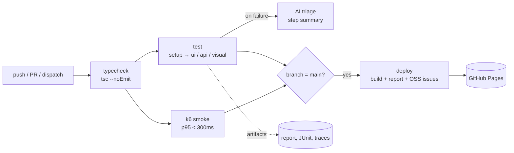

# Kiến trúc CI/CD cho test: nhanh, tin cậy, có báo cáo

Viết test mới chỉ là một nửa công việc. Nửa còn lại là **chạy chúng đúng lúc, đúng thứ tự, giữ lại bằng chứng và biến kết quả thành quyết định**. Bài này mổ xẻ pipeline thật của repo (`.github/workflows/ci.yml` và `update-snapshots.yml`) để bạn thấy từng quyết định kiến trúc đứng sau mỗi dòng YAML.

## Mục tiêu bài học

- Đặt test pyramid vào pipeline và áp dụng nguyên tắc fail fast.
- Thiết kế job song song, `needs`, `concurrency`, `permissions` hợp lý.
- Lưu artifacts hữu ích: HTML report, JUnit, trace.
- Có chính sách retries và flaky rõ ràng thay vì "chạy lại cho tới khi xanh".
- Tích hợp AI triage khi fail và publish báo cáo lên GitHub Pages.
- Quản lý secrets an toàn.

## Khái niệm

### Test pyramid trong pipeline

Pyramid không chỉ là hình vẽ về số lượng test; nó quyết định **thứ tự chạy** trong pipeline: rẻ và nhanh đi trước, đắt và chậm đi sau.

| Tầng | Ví dụ trong repo | Tốc độ | Đặt ở đâu |
|---|---|---|---|
| Tĩnh | `tsc --noEmit` (typecheck) | giây | Đầu tiên |
| API | project `api` (không cần browser) | vài giây | Cùng giai đoạn tests |
| UI/E2E | project `ui` (Chromium) | phút | Cùng giai đoạn tests |
| Visual | project `visual` (so ảnh) | phút | Cùng giai đoạn tests |
| Hiệu năng | k6 smoke | ~15 giây | Song song với tests |

### Fail fast

Nếu code còn không biên dịch được, chạy browser là lãng phí. Thứ tự trong repo:

**typecheck → (Playwright tests ‖ k6 smoke) → deploy (chỉ trên `main`)**

Mỗi giai đoạn chỉ bắt đầu khi giai đoạn trước xanh (`needs:`). Hai job nặng chạy **song song** (`‖`) vì chúng không phụ thuộc nhau, nên tổng thời gian bằng job chậm hơn chứ không phải tổng hai job.

### Sơ đồ



## Ví dụ chạy được

### 1. Khung của `ci.yml`

Bản rút gọn dưới đây phản ánh cấu trúc của [`.github/workflows/ci.yml`](https://github.com/nguyenvanlinh14/qa-agent-portfolio/blob/main/.github/workflows/ci.yml); hãy mở file thật để xem đầy đủ.

```yaml
name: CI

on:
  push:
    branches: [main]
  pull_request:
  workflow_dispatch:

# Một ref chỉ có một run: push mới sẽ huỷ run cũ đang chạy.
concurrency:
  group: ci-${{ github.ref }}
  cancel-in-progress: true

permissions:
  contents: read          # mặc định tối thiểu; job nào cần nhiều hơn thì tự nâng

jobs:
  typecheck:
    runs-on: ubuntu-latest
    timeout-minutes: 10
    steps:
      - uses: actions/checkout@v4
      - uses: actions/setup-node@v4
        with: { node-version: 22, cache: npm }
      - run: npm ci
      - run: npm run typecheck

  test:                                  # Playwright: setup -> ui + api + visual
    needs: typecheck
    runs-on: ubuntu-latest
    timeout-minutes: 30
    container:
      image: mcr.microsoft.com/playwright:v1.64.1-noble
    env:
      HOME: /root
    steps:
      - uses: actions/checkout@v4
      - run: npm ci
      - run: npm test                    # pretest chạy build; webServer tự dựng SUT
      - uses: actions/upload-artifact@v4
        if: always()
        with:
          name: playwright-report
          path: playwright-report/
          retention-days: 14
      - uses: actions/upload-artifact@v4
        if: always()
        with:
          name: test-reports
          path: reports/               # results.json + junit.xml
          retention-days: 14
      - name: AI failure triage
        if: failure()
        run: node scripts/ai-triage.mjs
        env:
          ANTHROPIC_API_KEY: ${{ secrets.ANTHROPIC_API_KEY }}

  k6:                                    # chạy song song với `test`
    needs: typecheck
    runs-on: ubuntu-latest
    steps:
      # ... xem bài 05

  deploy:
    needs: [test, k6]
    if: github.ref == 'refs/heads/main' && github.event_name != 'pull_request'
    runs-on: ubuntu-latest
    permissions:
      contents: read
      pages: write
      id-token: write
    environment:
      name: github-pages
      url: https://nguyenvanlinh14.github.io/qa-agent-portfolio/
    steps:
      - uses: actions/checkout@v4
      - uses: actions/setup-node@v4
        with: { node-version: 22, cache: npm }
      - run: npm ci
      - uses: actions/download-artifact@v4
        with: { name: playwright-report, path: playwright-report }
      - uses: actions/download-artifact@v4
        with: { name: test-reports, path: reports }
      - run: npm run oss:issues
        env:
          GITHUB_TOKEN: ${{ secrets.GITHUB_TOKEN }}
      - run: npm run build               # copy playwright-report/ vào dist/report/
      - uses: peaceiris/actions-gh-pages@v4   # push dist/ lên nhánh gh-pages
        with:
          github_token: ${{ secrets.GITHUB_TOKEN }}
          publish_dir: ./dist
          force_orphan: true                   # nhánh gh-pages chỉ giữ 1 commit
```

> Vì sao không dùng `actions/deploy-pages`? Cách đó cần bật Pages ở chế độ "GitHub Actions" (`build_type: workflow`), việc này cần quyền admin. Repo này phục vụ Pages từ nhánh `gh-pages`, nên deploy chỉ là một lần `git push` với `contents: write`.

Các quyết định đáng chú ý:

- **`concurrency` + `cancel-in-progress`**: tiết kiệm phút chạy khi bạn push liên tiếp. Với job ghi dữ liệu như `update-snapshots`, repo đặt `cancel-in-progress: false` để một lượt commit baseline đang dở không bị huỷ giữa chừng.
- **`permissions` tối thiểu**: token mặc định chỉ đọc. Chỉ job deploy được `contents: write` (để push nhánh `gh-pages`). Nếu một action bên thứ ba bị xâm phạm, thiệt hại bị giới hạn.
- **`if: always()` ở upload-artifact**: artifact **quan trọng nhất khi test fail**. Mặc định step chỉ chạy khi các step trước thành công; thiếu điều kiện này bạn mất report đúng lúc cần nó. (`if: ${{ !cancelled() }}` cũng được, nếu bạn không muốn upload khi run bị huỷ.)
- **`needs: [test, k6]`** ở deploy: chỉ publish khi mọi thứ xanh. Báo cáo công khai không bao giờ là báo cáo của một lần chạy đỏ.
- **`timeout-minutes`**: một job treo không được phép ngốn hết hạn mức phút của bạn.

### 2. Reporters và artifacts

[`playwright.config.ts`](https://github.com/nguyenvanlinh14/qa-agent-portfolio/blob/main/playwright.config.ts) cấu hình nhiều reporter cùng lúc để mỗi đối tượng đọc một định dạng:

```ts
reporter: [
  ['list'],                                                       // log dễ đọc
  ['html', { open: 'never', outputFolder: 'playwright-report' }], // cho con người
  ['json', { outputFile: 'reports/results.json' }],               // cho script, AI triage, build-site
  ['junit', { outputFile: 'reports/junit.xml' }],                 // cho công cụ CI/dashboard
  ...(isCI ? ([['github']] as const) : []),                       // annotation trên PR
],
use: { trace: 'on-first-retry', screenshot: 'only-on-failure' },
```

Ý nghĩa: HTML report là thứ người xem mở; `results.json` là "API" nội bộ cho script (trang chủ đọc nó để hiển thị số pass/fail, AI triage đọc nó để phân tích); JUnit để tích hợp với bất kỳ hệ thống nào hiểu định dạng đó; **trace** (ghi lại DOM, network, ảnh theo từng bước) là công cụ gỡ lỗi mạnh nhất, nên chỉ ghi khi retry để tiết kiệm dung lượng.

### 3. Retries và chính sách flaky

```ts
retries: isCI ? 2 : 0,
fullyParallel: true,
workers: isCI ? 2 : undefined,
forbidOnly: isCI,   // chặn lỡ commit test.only
```

Retry giúp pipeline không đỏ vì sự cố hạ tầng hiếm hoi, nhưng nó cũng **che giấu** flaky test. Chính sách lành mạnh:

1. **Retry tối đa 1-2 lần**, không hơn.
2. Test pass sau retry được Playwright đánh dấu **flaky**, không phải passed. Trang chủ của portfolio hiển thị con số này riêng (`REPORT_FLAKY`).
3. Flaky không phải "bình thường". Mỗi test flaky phải có ticket và hạn xử lý; quá hạn thì cách ly (`test.fixme` / tag `@quarantine`) chứ không để nó làm nhiễu tín hiệu của cả suite.
4. Sửa nguyên nhân gốc (chờ sai thứ, dữ liệu dùng chung, thứ tự phụ thuộc), đừng tăng timeout cho qua chuyện.
5. Đo tỉ lệ flaky theo thời gian; nó là chỉ số sức khoẻ của suite.

### 4. AI triage khi fail

Khi có test fail, bước `AI failure triage` (xem ở khối YAML trên, chỉ chạy `if: failure()`) đọc `reports/results.json` và gọi Anthropic API nếu có secret để phân loại và gợi ý nguyên nhân.

Script [`scripts/ai-triage.mjs`](https://github.com/nguyenvanlinh14/qa-agent-portfolio/blob/main/scripts/ai-triage.mjs) ghi kết quả vào `$GITHUB_STEP_SUMMARY`, nghĩa là bản phân tích hiện ngay trên trang run, và bỏ qua âm thầm khi không có khoá (ví dụ PR từ fork vốn không nhận secrets). Hai nguyên tắc: AI chỉ **đề xuất**, người quyết định; và không bao giờ cho nó quyền sửa code trực tiếp trên nhánh chính.

### 5. Publish báo cáo lên GitHub Pages

Job `deploy` gom mọi thứ thành một trang duy nhất: `build-site.mjs` render lessons, nhúng `playwright-report/` vào `dist/report/`, điền số liệu vào trang chủ. Kết quả là mỗi lần `main` xanh, `https://nguyenvanlinh14.github.io/qa-agent-portfolio/report/` luôn là báo cáo mới nhất. Cần bật Pages ở chế độ **GitHub Actions** (build type = workflow).

### 6. Workflow phụ: `update-snapshots.yml`

[`.github/workflows/update-snapshots.yml`](https://github.com/nguyenvanlinh14/qa-agent-portfolio/blob/main/.github/workflows/update-snapshots.yml) chạy bằng `workflow_dispatch`. Nó dùng cùng image Playwright với CI, tạo lại ảnh baseline rồi commit chúng về `main`:

```yaml
name: Update visual snapshots
on:
  workflow_dispatch:
concurrency:
  group: update-snapshots
  cancel-in-progress: false
permissions:
  contents: write          # chỉ workflow này được push
jobs:
  update:
    runs-on: ubuntu-latest
    container:
      image: mcr.microsoft.com/playwright:v1.64.1-noble
    env:
      HOME: /root
    steps:
      - uses: actions/checkout@v4
        with: { ref: main }
      - run: git config --global --add safe.directory "$GITHUB_WORKSPACE"
      - run: npm ci
      - run: npm run build
      - run: npx playwright test --project=visual --update-snapshots=all
      - run: |
          git config user.name "github-actions[bot]"
          git config user.email "41898282+github-actions[bot]@users.noreply.github.com"
          git add tests/visual/__screenshots__
          if git diff --cached --quiet; then
            echo "No baseline changes to commit."
          else
            git commit -m "test(visual): update Linux baselines"
            git push origin HEAD:main
          fi
```

Tách việc này khỏi CI chính là cố ý: baseline chỉ thay đổi khi con người chủ động bấm nút sau một thay đổi UI có chủ đích (rồi xem diff trong commit), không phải mỗi lần test fail. `safe.directory` cần thiết vì thư mục checkout thuộc user khác với user trong container.

### 7. Secrets

- Lưu ở *Settings → Secrets and variables → Actions*, truy cập qua `${{ secrets.NAME }}`; log tự động che giá trị.
- Chỉ truyền secret vào **step cần dùng** (`env:` ở cấp step), không đặt ở cấp workflow.
- PR từ fork không nhận secrets, nên bước dùng secret phải chịu được việc nó vắng mặt (như triage "skip quietly").
- Đừng `echo` secret, đừng ghi nó vào artifact hoặc report. Hãy xem lại report trước khi publish công khai.
- Dùng `GITHUB_TOKEN` có sẵn thay vì tạo PAT khi có thể, và giới hạn bằng `permissions`.

## Lỗi thường gặp

1. **Một job khổng lồ làm tất cả.** Không song song, khó đọc lỗi, retry phải chạy lại hết.
2. **Upload artifact không có `if: always()`** nên khi fail không còn gì để xem.
3. **Retries cao để "xanh cho đẹp".** Flaky bị chôn vùi, niềm tin vào suite giảm dần.
4. **Không có `concurrency`.** Hai push liên tiếp chạy chồng nhau, deploy cũ có thể ghi đè deploy mới.
5. **`permissions: write-all` mặc định.** Mở rộng bề mặt tấn công vô ích.
6. **Deploy không `needs` test.** Site công khai cập nhật dù test đỏ.
7. **Cache hoặc phiên bản không ghim.** `ubuntu-latest` và `npm install` thay đổi âm thầm; dùng `npm ci` và ghim image Playwright.
8. **Chạy test visual trên runner trần** rồi so với baseline tạo bằng máy khác. Luôn chạy trong cùng image.
9. **Đưa secret cho step chạy code không tin cậy** (ví dụ script từ PR của người ngoài).

## Bài tập thực hành

1. Vẽ lại sơ đồ mermaid trên cho một pipeline giả định có thêm job `lint` và `e2e` chia shard 3 phần (`--shard=1/3`).
2. Thêm `--shard` vào job `test` bằng `strategy.matrix`, rồi dùng `blob` reporter và `merge-reports` để gộp thành một HTML report.
3. Cố ý tạo test flaky (`Math.random()`), chạy CI và tìm nó trong HTML report ở nhãn "Flaky". Viết ticket mô tả nguyên nhân giả định.
4. Thêm bước `if: failure()` upload `test-results/` (chứa trace) với `retention-days: 7` và tải trace về mở bằng `npx playwright show-trace`.
5. Cho job `deploy` một `concurrency` group riêng với `cancel-in-progress: false`, và giải thích vì sao deploy nên khác job test.
6. Đọc kết quả AI triage cho một lần fail cố ý, chỉ ra một đề xuất đúng và một đề xuất sai/thiếu căn cứ.

## Checklist tóm tắt

- [ ] Thứ tự: typecheck → tests ‖ k6 → deploy, mỗi bước `needs` bước trước.
- [ ] `concurrency` huỷ run cũ; `permissions` tối thiểu, nâng theo job.
- [ ] Chạy test trong image Playwright cố định phiên bản.
- [ ] Reporters: html + json + junit + list (+ github trên CI).
- [ ] Artifacts upload với `if: always()`, có `retention-days`.
- [ ] `retries` ≤ 2, flaky được đếm riêng và có người chịu trách nhiệm.
- [ ] AI triage chỉ chạy khi fail, ghi vào step summary, bỏ qua khi không có key.
- [ ] Deploy chỉ trên `main`, chỉ khi test và k6 xanh.
- [ ] Baseline visual chỉ đổi qua workflow `update-snapshots` có chủ đích.
- [ ] Secrets giới hạn ở step cần dùng, không lộ qua log/artifact.
