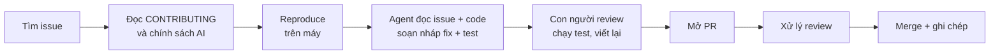

# OSS Playbook: quy trình đóng góp open source cùng AI agent

Đóng góp open source là cách nhanh nhất để học cách các đội giỏi viết và kiểm thử code, đồng thời tạo ra bằng chứng công khai về năng lực của bạn. Playbook này mô tả quy trình mà repo này dùng: **tìm issue → hiểu → tái hiện → agent soạn bản nháp → con người review và viết lại → mở PR → xử lý review**. AI giúp bạn nhanh hơn, nhưng **người chịu trách nhiệm cho mỗi dòng trong PR vẫn là bạn**.

## Mục tiêu

- Có quy trình lặp lại được từ "tìm issue" đến "PR được merge".
- Biết chia việc giữa agent (Claude Code) và con người.
- Giữ chuẩn đạo đức: không spam, minh bạch về việc dùng AI, tôn trọng thời gian của maintainer.
- Ghi chép lại mỗi PR để học và để trình bày về sau.

## Quy trình tổng quan



## Bước 1: Tìm issue

Script [`scripts/find-good-first-issues.mjs`](https://github.com/nguyenvanlinh14/qa-agent-portfolio/blob/main/scripts/find-good-first-issues.mjs) gọi GitHub search API để lấy các issue `good first issue` đang mở từ các repo ta theo dõi, ghi vào `dist/data/oss-issues.json` (trang chủ của portfolio hiển thị chúng ở mục OSS). Chạy cục bộ:

```bash
GITHUB_TOKEN=$(gh auth token) npm run oss:issues
cat dist/data/oss-issues.json | head
```

Repo nên theo dõi (công cụ bạn dùng hằng ngày nên là nơi bạn đóng góp trước, vì bạn hiểu ngữ cảnh):

- `microsoft/playwright`: test runner, reporters, tài liệu.
- `microsoft/playwright-mcp`: MCP server mà agent của bạn dùng để điều khiển browser.
- `grafana/k6`: công cụ tải. Thêm `grafana/k6-docs` cho tài liệu.
- Các reporter, plugin và tiện ích quanh Playwright.

Tìm thủ công cũng được:

```text
is:issue is:open label:"good first issue" no:assignee repo:microsoft/playwright
```

Tiêu chí chọn issue tốt cho người mới:

1. Mô tả rõ, có cách tái hiện hoặc kết quả mong đợi cụ thể.
2. **Chưa có ai nhận** và không có PR đang mở liên kết (kiểm tra cả phần comment lẫn tab "Linked pull requests").
3. Phạm vi nhỏ: một file hoặc một module, có test để làm theo.
4. Maintainer còn hoạt động (có phản hồi trong vài tuần gần đây).
5. Bạn hiểu *vì sao* nó là vấn đề. Nếu không, hãy chọn issue khác.

Nếu issue chưa được nhận, **để lại một comment ngắn** nói bạn muốn làm và cách tiếp cận dự kiến; chờ phản hồi hoặc ít nhất vài ngày trước khi bắt tay vào làm khối lượng lớn.

## Bước 2: Đọc CONTRIBUTING và chính sách của repo

Trước khi viết bất cứ dòng code nào:

- Đọc `CONTRIBUTING.md`, `CODE_OF_CONDUCT.md`, mẫu PR/issue (`.github/pull_request_template.md`).
- Tìm quy ước commit/PR (ví dụ Conventional Commits: `fix(test-runner): ...`), cách chạy test, linter, và có cần ký CLA hay không (nhiều dự án của Microsoft yêu cầu).
- **Tìm chính sách về nội dung do AI tạo ra.** Một số repo cấm, một số yêu cầu khai báo. Nếu có chính sách, tuân thủ nó nguyên văn. Không tìm thấy thì hỏi maintainer trong issue trước khi gửi PR.
- Fork repo, clone, tạo nhánh theo quy ước (`fix/issue-1234-short-desc`), cài dependencies và **chạy test hiện có để thấy chúng xanh** trước khi sửa.

## Bước 3: Reproduce

Không reproduce được thì chưa được sửa. Tự tay:

1. Viết một test (hoặc đoạn script nhỏ) làm lỗi xuất hiện, và xác nhận nó **fail vì đúng lý do** trong issue.
2. Ghi lại phiên bản, hệ điều hành, lệnh chạy.
3. Nếu không reproduce được, comment trong issue với thông tin bạn thu thập, đó cũng là đóng góp có giá trị.

Test fail này sau đó sẽ trở thành test hồi quy đi kèm PR.

## Bước 4: Agent soạn nháp, con người dẫn dắt

Đây là chỗ Claude Code phát huy tác dụng, nhưng theo **vai trò trợ lý**, không phải người lái.

Việc agent làm tốt:

- Đọc issue và khảo sát codebase xa lạ: tìm file liên quan, giải thích luồng chạy, liệt kê chỗ có thể gây lỗi.
- Đề xuất vài hướng sửa với ưu và nhược điểm.
- Soạn **bản nháp** fix và test theo phong cách các test lân cận.
- Chạy test cục bộ, đọc log lỗi, gợi ý bước tiếp theo.

Prompt mẫu (tuỳ chỉnh cho repo mục tiêu):

```text
Đọc issue <URL> và CONTRIBUTING.md của repo này.
1. Tóm tắt vấn đề bằng 3 câu, nói rõ hành vi hiện tại và hành vi mong đợi.
2. Tìm các file liên quan và giải thích luồng code dẫn đến lỗi.
3. Đề xuất 2 hướng sửa nhỏ nhất có thể; chưa sửa gì.
Sau khi tôi chọn hướng, viết test fail trước, rồi fix tối thiểu. Không refactor, không đổi
format ngoài phạm vi, theo đúng phong cách code và quy ước đặt tên xung quanh.
```

Việc **con người phải làm**, không giao cho agent:

- **Hiểu từng dòng thay đổi.** Nếu bạn không giải thích được vì sao nó đúng thì không được gửi.
- Tự chạy toàn bộ test liên quan, linter, build trên máy bạn; không tin lời "đã test xong" của agent.
- **Viết lại** theo ý bạn và theo phong cách dự án: đổi tên cho đúng quy ước, xoá phần thừa, bỏ comment giải thích hiển nhiên, thu nhỏ diff.
- Kiểm tra agent không "bịa": API không tồn tại, test chỉ pass vì sửa luôn phần kỳ vọng, hay xoá test cũ cho xanh.
- Viết phần mô tả PR bằng lời của bạn.

Quy tắc an toàn khi để agent làm việc trên máy bạn: chạy trong nhánh riêng, không cấp quyền đẩy (push), duyệt từng lệnh có tác dụng phụ, và không dán secret vào prompt.

## Bước 5: Mở PR

Một PR tốt dễ review: **nhỏ, một mục đích, có test, có ngữ cảnh**.

Mẫu mô tả:

```markdown
## Summary
Fixes #1234. <Một–hai câu: vấn đề là gì, sửa thế nào và vì sao cách này.>

## Changes
- <thay đổi chính 1>
- Added a regression test that fails before and passes after this change.

## Testing
- `npm run test -- <đường dẫn test>` : pass
- Manually verified: <các bước>

## Notes
- <điểm cần reviewer chú ý, đánh đổi, phương án đã cân nhắc>
- AI disclosure: I used Claude Code to explore the codebase and draft an initial
  version of the fix and test. I reviewed, rewrote and ran everything locally, and
  I'm responsible for the final change.
```

Về dòng khai báo AI: đặt nó theo **chính sách của repo**. Nếu repo yêu cầu khai báo hoặc cấm, làm đúng như vậy; nếu không có quy định, vẫn nên trung thực và ngắn gọn. Che giấu thì dễ gây mất niềm tin, khai báo thì hầu như không mất gì.

Checklist trước khi bấm "Create pull request":

- [ ] Liên kết issue bằng `Fixes #<số>` (hoặc `Refs` nếu chưa hoàn tất).
- [ ] Diff nhỏ nhất có thể, không chứa file lạ (lockfile, format hàng loạt).
- [ ] Test mới fail trước và pass sau khi sửa.
- [ ] Linter, build và toàn bộ test liên quan xanh.
- [ ] Commit theo quy ước; đã ký CLA/DCO nếu yêu cầu.
- [ ] Tự đọc lại diff trên giao diện GitHub như một reviewer.

## Bước 6: Xử lý review

- Phản hồi lịch sự, ngắn gọn, và nhanh trong khoảng vài ngày. Coi mỗi comment là thông tin, không phải sự công kích.
- Sửa theo yêu cầu bằng commit mới (đừng force-push gây khó theo dõi, trừ khi dự án yêu cầu squash/rebase).
- Không đồng ý thì nêu lý do và bằng chứng, rồi tôn trọng quyết định của maintainer. Họ chịu trách nhiệm bảo trì lâu dài.
- Có thể dùng agent để *hiểu* comment hoặc nháp lời sửa, nhưng bạn đọc và trả lời bằng giọng của mình.
- CI đỏ: đọc log trước khi hỏi, đa số lỗi do chính thay đổi của bạn.
- PR im lặng nhiều tuần: một lời nhắc lịch sự là đủ, không spam.
- Nếu PR bị đóng, hỏi xem có học được gì và tiếp tục. Bị từ chối không phải chuyện cá nhân.

## Đạo đức và nguyên tắc

1. **Không spam PR do AI tạo.** Không chạy hàng loạt agent để mở PR vào mọi issue dễ. Maintainer là con người với thời gian hữu hạn; mỗi PR kém chất lượng là một khoản nợ họ phải trả.
2. **Bạn là tác giả chịu trách nhiệm.** Nếu bạn không hiểu và không thể bảo vệ thay đổi trong review thì đừng gửi.
3. **Minh bạch** về việc dùng AI theo chính sách của dự án.
4. **Tôn trọng việc "nhận issue".** Đừng gửi PR cho issue người khác đang làm; đừng "nhận" nhiều issue rồi bỏ.
5. **Chất lượng hơn số lượng.** Một PR được merge, được hiểu kỹ, có giá trị hơn mười PR bị đóng.
6. **Không chép code** mà bạn không có quyền dùng; tôn trọng giấy phép.
7. **Lịch sự và kiên nhẫn**, kể cả khi review nghiêm khắc.
8. **Bảo mật**: không đưa token, thông tin riêng tư vào prompt, commit hay PR. Lỗ hổng bảo mật thì báo theo `SECURITY.md`, không mở issue công khai.

## Template ghi chép mỗi PR

Tạo một ghi chép ngắn cho mỗi lần đóng góp (trong ghi chú cá nhân hoặc một file riêng). Nó giúp bạn nhìn lại quy trình, và là chất liệu thật khi phỏng vấn.

```markdown
# <repo> #<issue> — <tiêu đề ngắn>

- Link issue: 
- Link PR: 
- Ngày bắt đầu / ngày merge: 
- Trạng thái: draft | open | changes requested | merged | closed

## Vấn đề (3 câu)

## Reproduce
- Môi trường:
- Lệnh / test làm lỗi xuất hiện:

## Nguyên nhân gốc

## Cách sửa và lý do chọn
- Phương án đã cân nhắc:

## Phần agent làm / phần tôi làm
- Agent: 
- Tôi: (review, chạy test, viết lại những gì?)
- Chỗ agent sai hoặc thiếu mà tôi phải sửa:

## Phản hồi từ maintainer
- 

## Bài học
- Kỹ thuật:
- Quy trình:
- Lần sau tôi sẽ làm khác:
```

## Cách lặp lại

1. Mỗi tuần chạy `npm run oss:issues`, chọn tối đa **một** issue phù hợp.
2. Dành thời gian đọc code và reproduce nhiều hơn viết code.
3. Mở PR nhỏ, theo dõi sát, ghi chép đầy đủ.
4. Sau 3-5 PR được merge, bạn hiểu repo đủ để review PR người khác và trả lời issue; đó là mức đóng góp giá trị nhất.
